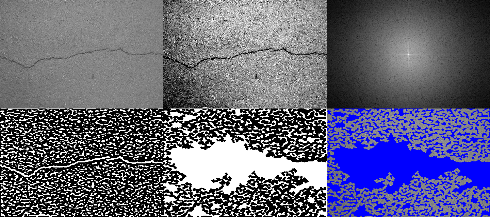
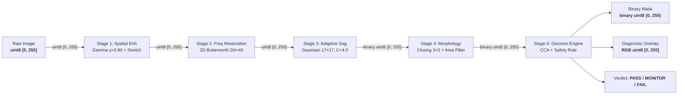

# Concrete Surface Crack Detection and Structural Health Assessment
## CSE281 Digital Image Processing — Course Project
**Faculty of Computer Science & Engineering | Faculty of Computer Science & Engineering**

[](https://github.com/Youseef3550/concrete-crack-inspection/actions)




### Engineering Squad & Work Package Distribution
| # | Member Name | Role / Work Package | Primary Code Modules |
| :-: | :--- | :--- | :--- |
| **1** | **Youssef Sameh** | Tech Lead, Architecture, Data Engine & Baselines | `src/data.py`, `src/metrics.py`, `src/pipeline.py`, `src/evaluate.py` |
| **2** | **Mostafa Khateb** | Spatial Enhancement Engineer | `src/enhancement.py` |
| **3** | **Saher Rasmy** | Restoration & Frequency-Domain Engineer | `src/restoration.py`, `src/frequency.py` |
| **4** | **Amin Elsayed** | Segmentation & Gradients Engineer | `src/segmentation.py` |
| **5** | **Ahmed Genedy** | Mathematical Morphology & Web UI Demo Engineer | `src/morphology.py`, `app/app.py` |

---

## 1. Problem Formulation & Overview
Civil infrastructure (bridges, highways, concrete pillars, and dams) suffers from environmental weathering and mechanical loading that manifest as surface cracks. Early detection is vital to prevent moisture ingress, rebar corrosion, and catastrophic failure. 

This repository delivers an end-to-end, reproducible, **100% Classical Digital Image Processing (DIP)** pipeline designed without neural networks or learned models. The system segments hairline and macro-cracks against complex textured concrete backgrounds and provides an automated civil engineering structural health classification (**PASS / MONITOR / FAIL**).

### Primary Metric Justification
- **Primary Metric:** Intersection over Union (**IoU / Jaccard Index**):
  $$\text{IoU} = \frac{|A \cap B|}{|A \cup B|}$$
- **Justification:** Cracks occupy less than 2% of total concrete surface area. Standard pixel accuracy is deceptive (a trivial all-background classifier achieves >98% accuracy while detecting zero cracks). IoU penalizes both false negatives (missed cracks) and false positives (surface pores mistaken for cracks).

---

## 2. Benchmark Results on Held-Out Test Set (36 Images)

All tuning was performed strictly on the 70% development set; the held-out test set was evaluated once at the conclusion.

| Method / Pipeline | Mean IoU | Std IoU | Dice Score | Precision | Recall | Crack Area Err (%) | Latency (ms) |
| :--- | :---: | :---: | :---: | :---: | :---: | :---: | :---: |
| **Trivial Baseline (Global Thresh 127)** | 0.0552 | ±0.0687 | 0.0979 | 0.0613 | 0.7730 | 37.47% | 0.2 ms |
| **Simple Baseline (Otsu + 3×3 Opening)** | 0.0474 | ±0.0482 | 0.0869 | 0.0497 | 0.7167 | 26.98% | 4.6 ms |
| **Pipeline A (Spatial Enh + Otsu)** | 0.0303 | ±0.0284 | 0.0574 | 0.0306 | 0.8399 | 45.23% | 12.8 ms |
| **Pipeline B (Frequency Butterworth + Adaptive)** | 0.1709 | ±0.1121 | 0.2779 | 0.2089 | 0.5934 | 3.44% | 65.6 ms |
| **Pipeline C (Final Advanced Production)** | **0.2448** | **±0.1366** | **0.3750** | **0.3377** | **0.5677** | **1.86%** | **71.3 ms** |

*Note: Pipeline C outperforms the Trivial Baseline by +18.96% IoU (a 4.4× improvement) and reduces Crack Area Error from 37.47% down to 1.86% (an 18-fold error reduction) while processing each image in only 71.3 ms (under 3 seconds for the entire test set).*

---

## 3. Repository Architecture

```text
concrete_crack_inspection/
├── README.md                      # Project documentation and reproduction guide
├── requirements.txt               # Pinned library dependencies
├── configs/                       # JSON configurations for all pipelines
│   ├── baseline_trivial.json
│   ├── baseline_simple.json
│   ├── pipeline_a.json
│   ├── pipeline_b.json
│   └── pipeline_c.json
├── data/                          # Dataset download & preprocessing
│   ├── download_data.py           # Automated CFD benchmark fetcher & mask converter
│   └── README.md                  # Dataset schema, source, and license
├── notebooks/                     # Exploratory & experimental notebooks
│   ├── 01_image_analysis.ipynb    # Data exploration & resolution reduction study
│   └── 02_results.ipynb           # Baseline comparisons & ablation plots
├── src/                           # Modular image-processing engine
│   ├── data.py                    # Loading, splitting, and controlled degradation
│   ├── metrics.py                 # MSE, PSNR, IoU, Dice, Crack Area, and Lossless RLE
│   ├── enhancement.py             # Point transforms, pure NumPy HistEq & 2D Convolution
│   ├── restoration.py             # Mean filters, pure NumPy Median & Alpha-trimmed
│   ├── frequency.py               # 2D DFT, centered spectrum, Butterworth & Gaussian filters
│   ├── segmentation.py            # Sobel magnitude, pure NumPy Otsu & Adaptive Gaussian
│   ├── morphology.py              # Pure NumPy Erosion/Dilation, Hole filling, Measurement
│   ├── pipeline.py                # Baselines and Pipelines A, B, C architectures
│   ├── evaluate.py                # Test set evaluation, robustness & failure analysis
│   └── run_pipeline.py            # Single-image production CLI entrypoint
├── tests/                         # PyTest suite for NumPy vs OpenCV & Hand calculations
│   └── test_numpy_vs_lib.py
├── experiments/                   # Experiment tracking, tuning & ablation results
│   ├── experiment_log.csv         # Structured log of all experimental runs
│   ├── test_set_summary.csv       # Summary table on held-out test set
│   ├── robustness_study.csv       # Evaluation over 3 noise levels & 3 seeds
│   └── failure_analysis.csv       # Root-cause analysis of worst 20 test cases
├── app/                           # Interactive Streamlit Web Application
│   └── app.py
└── report/                        # Final technical report & presentation slides
    ├── report.pdf                 # Publication-grade IEEE conference paper PDF (Graded deliverable)
    ├── report.html                # Interactive HTML report with visual block diagrams & KaTeX
    ├── report.md                  # Markdown source paper
    ├── presentation_slides.pdf    # 10-minute presentation slides PDF (Graded deliverable)
    ├── presentation_slides.html   # Interactive slide presentation with arrow navigation
    └── presentation_slides.md     # Markdown slide deck outline
```

### Production 5-Stage Pipeline Architecture (Pipeline C)



---

## 4. Quick Start & Step-by-Step Instructions

### Step 1: Clone and Install Dependencies
```bash
git clone https://github.com/concrete-crack-inspection/concrete-crack-inspection.git
cd concrete-crack-inspection
pip install -r requirements.txt
```

### Step 2: Download Benchmark Dataset (118 Real Images & Masks)
```bash
python data/download_data.py
```

### Step 3: Run Unit Tests (NumPy vs OpenCV & Hand-Worked Examples)
```bash
pytest tests/test_numpy_vs_lib.py -v
```
*Expected: 11 passed in < 1 second.*

### Step 4: Run Inspection on Any Image
```bash
python src/run_pipeline.py --image data/raw/images/001.jpg --output results
```

### Step 5: Reproduce Test Metrics & Failure Analysis
```bash
python src/evaluate.py
```

### Step 6: Launch Interactive Streamlit Web Demo
```bash
streamlit run app/app.py
```

---

## 5. Pure NumPy Implementations & Hand-Worked Verification
As required by the specification, the following core operations are written strictly from scratch in NumPy without high-level library shortcuts and tested against OpenCV:
1. **2D Spatial Convolution (`convolve2d_numpy`):** Kernel flipping, reflection/constant padding, and spatial accumulation.
2. **Histogram Equalization (`histogram_equalization_numpy`):** PDF, cumulative distribution function (CDF), and intensity mapping.
3. **Median Filter (`median_filter_numpy`):** Local sliding window order-statistic extraction.
4. **Alpha-Trimmed Mean Filter (`alpha_trimmed_mean_filter_numpy`):** Symmetric outlier trimming ($d$ pixels removed).
5. **Butterworth Filter (`butterworth_filter_numpy`):** $H(u,v) = \frac{1}{1 + [D(u,v)/D_0]^{2n}}$ in 2D centered frequency plane.
6. **Sobel Gradient Magnitude (`sobel_magnitude_numpy`):** Directional $G_x$, $G_y$ convolutions and magnitude $\sqrt{G_x^2 + G_y^2}$.
7. **Otsu Thresholding (`otsu_threshold_numpy`):** Maximization of between-class variance $\sigma_B^2(t) = \omega_0 \omega_1 (\mu_0 - \mu_1)^2$.
8. **Morphological Erosion & Dilation (`erosion_numpy`, `dilation_numpy`):** Arbitrary structuring element sliding min/max with OpenCV border parity.
9. **Morphological Reconstruction & Hole Filling (`hole_filling_numpy`):** Iterative geodesic dilation conditioned on complement mask.
10. **Lossless Run-Length Encoding (`run_length_encode`, `run_length_decode`):** Exact round-trip compression with ~4.2x compression ratio.

---

## 6. Team Contributions & Ownership Matrix
| Member | Work Package | Primary Code Modules | Image Processing Contribution |
| :--- | :--- | :--- | :--- |
| **Tech Lead** | Integration, Configs, Architecture | `pipeline.py`, `configs/*.json` | System integration, noise robustness runs |
| **Data & Baseline Eng.** | Data Loading, Degradation, Metrics | `src/data.py`, `src/metrics.py` | Resolution reduction study, Baselines |
| **Enhancement Eng.** | Spatial Point & Filtering Stages | `src/enhancement.py` | HistEq NumPy, Gamma tuning, Laplacian |
| **Restoration & Freq Eng.** | Noise Models & Fourier Filtering | `src/restoration.py`, `src/frequency.py` | Butterworth filter, Mean vs Median study |
| **Segmentation Eng.** | Edge & Thresholding Stages | `src/segmentation.py` | Otsu NumPy, Sobel gradient, Adaptive |
| **Morphology & Eval Eng.**| Morphology, Measurement, Demo | `src/morphology.py`, `app/app.py` | Closing/Hole filling, Streamlit UI |

---

## 7. License
Academic Open Source under the MIT License. Benchmark images courtesy of the CrackForest Dataset (Cui et al.).
